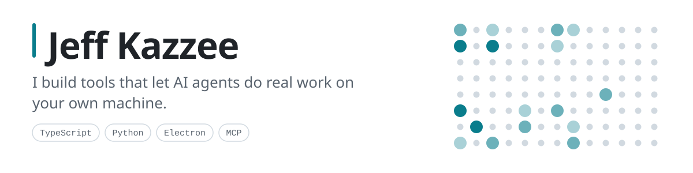
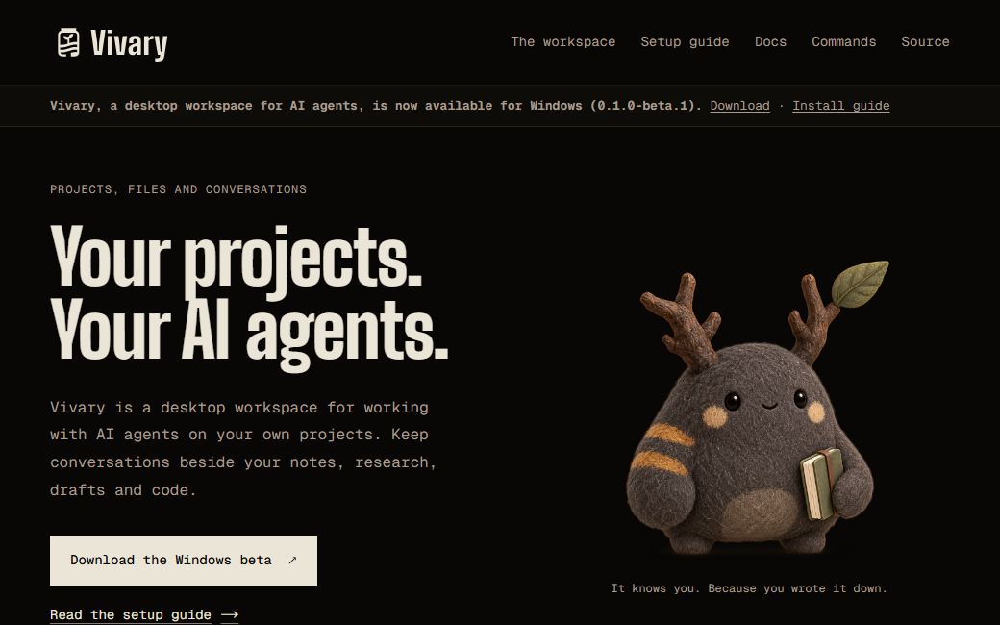
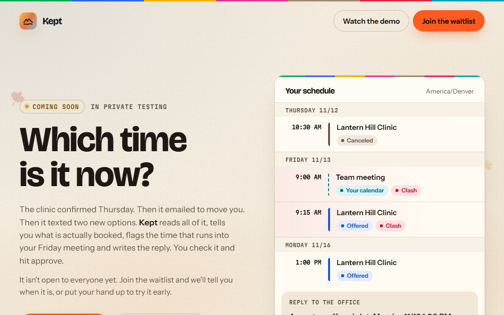

<picture>
  <source media="(prefers-color-scheme: dark)" srcset="assets/banner-dark.svg">
  <source media="(prefers-color-scheme: light)" srcset="assets/banner-light.svg">
  
</picture>

I taught myself to code, and I learn a thing by shipping something that uses it. I am looking for a software engineering job.

## What I'm building

| Project | What it does | State |
| --- | --- | --- |
| [Vivary](https://www.vivaryagent.xyz/) | A desktop workspace for working with AI agents on your own projects. Conversations sit beside your notes, drafts and code, and the files stay on your machine. | [Beta, 0.1.0-beta.1](https://github.com/vivary-dev/vivary/releases/tag/v0.1.0-beta.1). Windows first. |
| [Kept](https://mystic-marvel-866w.here.now/) | An agent that reads a clinic's messages, works out which appointment time is booked, checks new times against your calendar and drafts the reply. It sends nothing on its own, and every step has Undo. [Source](https://github.com/Jeff-Kazzee/kept). | Hackathon build, in private testing |
| [PS5 Agent Remote](https://github.com/Jeff-Kazzee/ps5-agent-remote) | A PS5 controller in your browser, plus tools that let an AI agent see the screen, press buttons and type. An agent can walk, jump, aim and fight, and it sees what happened. | [Released, v0.1.0](https://github.com/Jeff-Kazzee/ps5-agent-remote/releases/tag/v0.1.0). Windows only today. |
| [Callout](https://github.com/The-Little-AI-Company/callout) | A Windows tray app. Press a hotkey over any text. It tells you whether the text is trying to manipulate you, and whether its claims hold up against sources it fetched. Unsure is a real answer. | [Released, v0.2.0](https://github.com/The-Little-AI-Company/callout/releases/tag/v0.2.0) |

<table>
  <tr>
    <td width="50%"></td>
    <td width="50%"></td>
  </tr>
</table>

## A company licensed my guides

I wrote [66 plain-English beginner guides](https://github.com/Jeff-Kazzee/zo-computer-101-guides) for Zo Computer and published them free. Zo Computer paid to license them as inspiration for its [official tutorials](https://www.zo.computer/tutorials). The guides stay free, and my name stays on them. I wrote down [how it happened](https://jeffkazzee.dev/blog/a-company-paid-me-for-guides-i-gave-away/).

## How I work

- I build with AI coding agents every day, and I review what they write.
- I write down each design decision. Kept has [24 decision records](https://github.com/Jeff-Kazzee/kept/tree/prod/docs/decisions), one for each choice and each review round.
- I let code check what a model says. In [Kept](https://github.com/Jeff-Kazzee/kept#readme), a quote must appear word for word in the message, or the app throws it out.
- I ship a release with its checksums and a build record. See the files on the [Vivary beta](https://github.com/vivary-dev/vivary/releases/tag/v0.1.0-beta.1).
- I say what does not work yet. [PS5 Agent Remote](https://github.com/Jeff-Kazzee/ps5-agent-remote#readme) runs on Windows only today, and its README says so.

## Find me

[jeffkazzee.dev](https://jeffkazzee.dev) · [Writing](https://jeffkazzee.substack.com) · [Email](mailto:jeffkazzee@gmail.com)

Last checked 2026-11-06.
